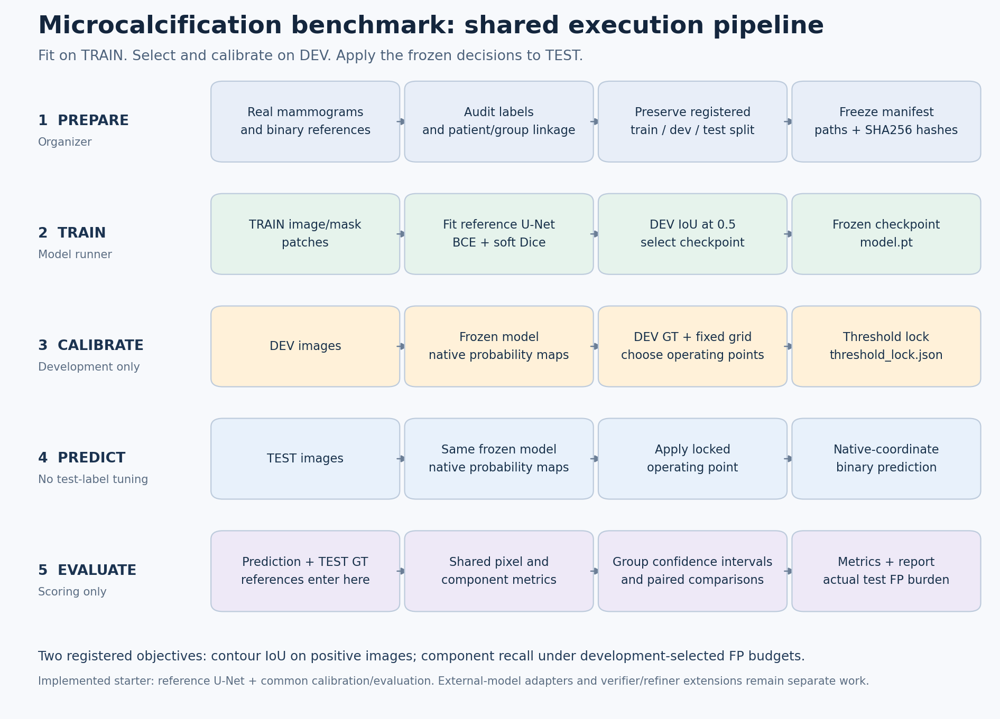

# Microcalcification segmentation benchmark handoff

**A runnable starter and proposed evaluation protocol. Real-data benchmarking is not complete.**

This package supports a shared workflow: prepare the data once, train different models against the same split definitions, export native-resolution predictions, and evaluate them with one metric implementation.

The original handoff and repository audit are dated **November 15, 2026**. This edition translates all documentation into English and adds a pipeline guide. It does not change training code, metric definitions, or historical numerical results.

## Data policy: real medical images only

**All official benchmark training, development, calibration, and test inputs must be real medical images from the organizer's audited manifests.** Synthetic lesions, rendered mammograms, procedural objects, and generated synthetic training patches are excluded; there is no synthetic-data benchmark track in this project.

Cropping, flips, and declared intensity normalization of real images are ordinary transformations of real data. They do not introduce generated lesions. Foundation-model pretraining and its data exposure must be declared separately; medical fine-tuning and benchmark evaluation still use only the eligible real images.

The optional procedural demo and unit-test fixtures are software checks only. Their arrays, checkpoints, and scores are excluded from official benchmark fitting, calibration, test cohorts, and result tables.

## Start here

1. [Pipeline guide](docs/PIPELINE.md): the workflow, model inputs/outputs, and implemented versus proposed stages.
2. [Student quickstart](docs/STUDENT_QUICKSTART.md): executable commands and submission requirements.
3. [Shared protocol](docs/PROTOCOL.md): splits, labels, operating points, metrics, and statistics.
4. [Organizer checklist and next steps](NEXT_STEPS.md).
5. [Model readiness](docs/MODEL_READINESS.md): what can be reused and what still needs an adapter.
6. [Analysis and research directions](reports/ANALYSIS_AND_NEXT_STEPS.md): historical findings, use cases, and publication paths.



The test references enter the **final evaluator only**. Checkpoint and threshold selection use development data. See the pipeline guide for the separate checkpoint-selection and threshold-calibration steps.

## Optional software check: procedural demo outside the benchmark

Python 3.10 or later; Python 3.11 is a suggested setup target. Run these commands from the package root after extraction. The exact environment used for verification is recorded in [VERIFICATION.json](reports/VERIFICATION.json).

```bash
python -m venv .venv
# Linux: source .venv/bin/activate
# Windows PowerShell: .venv\Scripts\Activate.ps1
python -m pip install -r requirements.txt
python -m unittest discover -s tests -v
python -m mcbench demo --out runs/synthetic-demo
```

The demo generates **procedural bright-speck arrays**, calibrates thresholds on development data, and evaluates a synthetic test split. These arrays are not mammograms, and the results provide no evidence of medical performance. Running the demo/evaluator requires no GPU, SSH, pretrained model, patient data, or legacy project checkout.

The optional reference U-Net trainer requires PyTorch. Install a build appropriate for your hardware and follow the quickstart. This independently implemented U-Net is not the historical PlainUNet or DINO checkpoint architecture.

## What is included?

- Pixel and component metrics; tiny/regular by isolated/cluster subgroups; bounds for subgroup counts when maximum matchings are ambiguous.
- Split/group/path/hash checks, development-only threshold locking, FP-budget operating points, group bootstrap intervals, and paired comparisons.
- A reference U-Net trainer and native-coordinate tiled/Hann inference, a manifest converter, and a prediction interface for other models.
- Analysis of existing CSAW44 aggregate results. No additional real medical-cohort experiment was performed for this handoff or its English documentation update.

Complete nnU-Net, DinoUNet, DeepMiCa, and MedSAM adapters are not bundled. No real-data benchmark or new independent held-out result is claimed.

## Repository and dependencies

Target repository: [AlexPham19/mcseg-bench](https://github.com/AlexPham19/mcseg-bench), audited commit `d7ac04e89e6fbe85165a0c33836f979b9b7d59b9`. That snapshot provides split definitions and a validator. This package independently supplies a starter for the missing execution/evaluation workflow. No changes have been pushed to GitHub.

The package contains no medical images/masks, DICOM files, actual cohort IDs, model checkpoints, credentials, or vendor source. The previously authorized three-case illustration bundle remains a separate deliverable. Obtain datasets, external libraries, and weights under their respective access and license terms.

The starter does not depend on the existing research project or remote server. See [DEPENDENCIES.json](DEPENDENCIES.json), [verification](reports/VERIFICATION.json), and the [English-edition change record](reports/ENGLISH_EDITION.json).

To verify delivered files after extraction:

```bash
python scripts/verify_integrity.py
```
