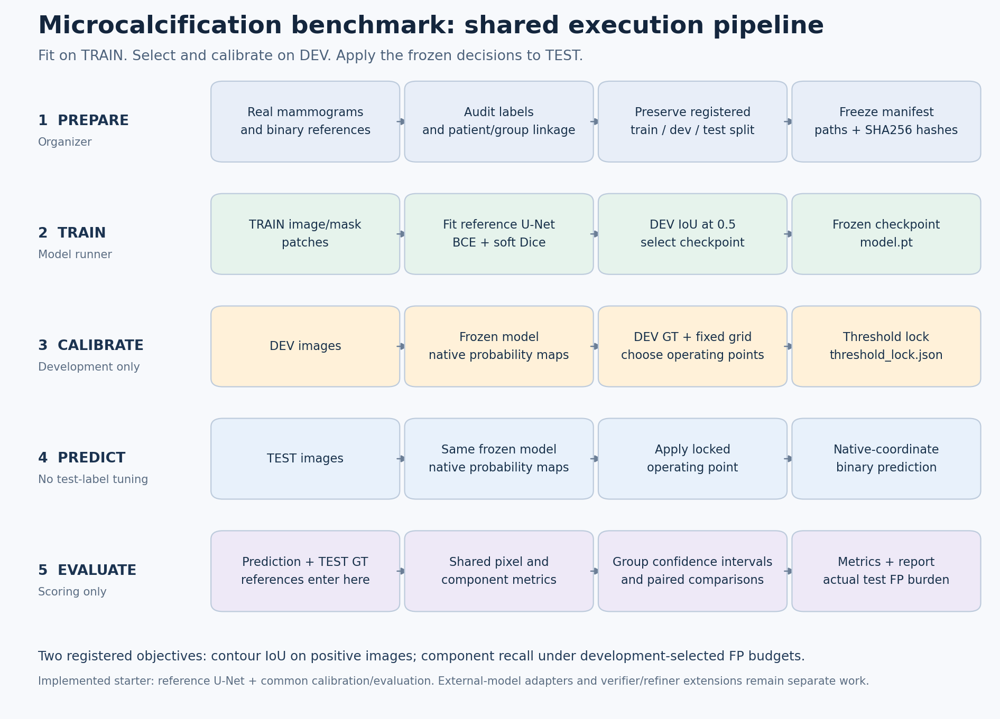
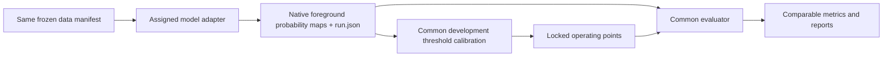

# Pipeline guide

This guide explains the benchmark workflow, the bundled reference model, and the historical research systems. **Only the reference U-Net and shared evaluation workflow are implemented in this starter.** Other model adapters and the component-verifier/refiner proposal require additional work.

## Data policy: real medical images only

**All official benchmark training, development, calibration, and test inputs must be real medical images from the organizer's audited manifests.** Synthetic lesions, rendered mammograms, procedural objects, and generated synthetic training patches are excluded; there is no synthetic-data benchmark track in this project.

Cropping, flips, and declared intensity normalization of real images are ordinary transformations of real data. They do not introduce generated lesions. Foundation-model pretraining and its data exposure must be declared separately; medical fine-tuning and benchmark evaluation still use only the eligible real images.

The optional procedural demo and unit-test fixtures are software checks only. Their arrays, checkpoints, and scores are excluded from official benchmark fitting, calibration, test cohorts, and result tables.

## 1. The workflow in one view



```text
ORGANIZER: source data + annotation audit + patient/group audit
                              |
                     Freeze manifest and hashes
                     /           |           \
                  TRAIN         DEV         TEST
                    |             |           |
MODEL RUNNER: fit model ---------->|           |
                    |      select checkpoint  |
                    +--------> frozen model    |
                                  |           |
                    DEV images -->|<-- TEST images
                                  |
                      native probability maps
                         /                \
              DEV probabilities      TEST probabilities
                      + DEV GT              +
                         |          locked operating point
                calibrate thresholds        |
                         |              binary mask
                 threshold_lock.json        + TEST GT
                         +----------------->|
                                    shared evaluation
                                           |
                                metrics + CI + report
```

The ASCII diagram expresses data roles; development/test inference are separate commands. Test GT is used for final scoring, not for fitting, checkpoint selection, prompting, candidate filtering, or threshold selection. File-validation code may inspect reference-file hashes; the starter itself does not enforce hidden-label access controls.

### Who does what?

| Role | Responsibility | Deliverable |
|---|---|---|
| Organizer | Prepare references, verify grouping/labels, preserve split membership | Frozen private data manifest and preparation specification |
| Model runner | Implement/train the assigned model; produce native probabilities | Checkpoint/configuration, development/test maps, run metadata |
| Calibration stage | Choose operating points from development references only | `threshold_lock.json` |
| Evaluator/organizer | Apply locked operating points to the specified split and compute common metrics | Per-image/aggregate JSON, confidence intervals, paired comparisons |

## 2. Data preparation and the manifest

Input: prepared grayscale images and binary references in their original coordinate system. The organizer establishes what foreground means, whether background is sufficiently annotated, and whether supplied groups identify the same patient across related images.

`scripts/prepare_manifest.py` converts existing split CSVs to the package's manifest format and computes image/mask SHA256 hashes. It does not create new partitions or certify annotations. `python -m mcbench validate` checks identifiers, split/group separation, safe paths, duplicate-image hash leakage, file existence, and declared file hashes.

```text
data/
  fold1.csv                   # case_id, group_id, split, paths, label status, hashes
  csaw/
    images/                   # authorized local source images
    masks/                    # audited binary references
```

Freeze the complete manifest before calibration, including test rows if test evaluation is planned. Use separate manifests for expert reference A/B. The reference trainer and threshold calibration require audited `dense_verified` training/development labels; `unknown` does not mean negative. Contour-positive and assumed-empty test references are reported separately from primary metrics.

## 3. Fit the reference U-Net and choose a checkpoint

The `train` command in `mcbench/__main__.py` calls `baseline.train`:

1. Select the manifest's training and development rows. Do not use test labels to fit or select.
2. Normalize each image using its positive-valued input pixels: first and 99.5th percentiles, clip to [0,1], preserve coordinates. Here “positive-valued” means intensity>0, **not GT-positive pixels**. Constant/empty intensity ranges return zeros.
3. Select a training image uniformly. If it has foreground, choose a foreground-centered crop with probability0.5; otherwise draw a uniform crop. The foreground center is sampled from GT pixels, not uniformly from GT components. This is not component-balanced sampling.
4. Extract a 256×256 patch by default, pad small images as implemented, and apply paired horizontal/vertical flips to image and mask.
5. Fit the U-Net with equally weighted BCE-with-logits and soft Dice loss using AdamW. Default budget: 50 epochs ×128 steps, batch size 4, learning rate 1e-3, seed 42.
6. After each epoch, run native-coordinate tiled inference on development images. At threshold 0.5, compute foreground macro IoU over positive development images. Save `model.pt` when this improves; retain the earlier epoch on ties.

```text
image patch B×1×256×256
           |
    Conv/GroupNorm/ReLU blocks --> skip at 256×256, width 16
           |
        max-pool
           |
    Conv/GroupNorm/ReLU blocks --> skip at 128×128, width 32
           |
        max-pool
           |
      bottleneck 64×64, width 64
           |
    bilinear upsample + concatenate skip + convolution blocks
           |
    bilinear upsample + concatenate skip + convolution blocks
           |
        1×1 convolution
           |
    foreground logits B×1×256×256
           |
         sigmoid for inference
```

Base width/patch size are configurable. Each convolution block has two 3×3 convolutions, each followed by GroupNorm/ReLU. This is a small independent two-level U-Net, without DINO pretraining. It is not the graph of the historical PlainUNet or DinoUNet checkpoint.

`training.json` records the recipe, history, selected weight hash, manifest fingerprint, and training/development input fingerprints. The recipe is a starting baseline, not an established optimum or a fair architecture comparison with differently pretrained historical systems.

## 4. Produce full-image probabilities

The `predict` command calls `baseline.predict` and `baseline.tiled`:

```text
original H×W grayscale image
    -> deterministic per-image intensity normalization
    -> overlapping native-coordinate tiles
    -> U-Net logits -> sigmoid probabilities
    -> weighted Hann-window stitching
    -> crop only padding back to original H×W
    -> <case_id>.npy float foreground probability in[0,1]
```

Default inference uses the trained patch size and half-patch stride:256/128 for the default model. A positive Hann-weight floor prevents zero-weight border pixels. Prediction does not load reference masks. The output is a probability map, not yet a final binary mask or set of alerts.

Files:

```text
runs/unet42/
  model.pt
  training.json
runs/unet42-dev/
  <case_id>.npy
  run.json
runs/unet42-test/
  <case_id>.npy
  run.json
```

`run.json` supplies the selected model hash, versioned pipeline ID, split role, and relevant inference configuration. Model hash/pipeline ID must agree between development and test outputs.

## 5. Calibrate and lock thresholds on development data

Checkpoint selection and operating-threshold selection are separate:

```text
epoch candidates + DEV GT
    -> best checkpoint at fixed threshold0.5
    -> freeze checkpoint
    -> DEV probabilities + DEV GT
    -> search0.05,0.10,...,0.95
    -> save one segmentation operating point and FP-budget operating points
```

- **`segmentation`:** maximize development positive-image foreground macro IoU, with the protocol's tie breaks.
- **`cad_fp0.5`, `cad_fp1`, `cad_fp2`, `cad_fp4`, `cad_fp8`:** maximize development component recall while satisfying the corresponding FP/image budget.
- If no grid point meets a budget, record **infeasible**. Do not derive a replacement from test labels.

The `lock` command writes the threshold grid, selected points, full development curve, development input/prediction fingerprints, model hash, pipeline ID, and manifest hash. Later evaluation checks the manifest/model/pipeline identity. These checks support reproducibility but are not tamper-proof model execution attestation or access control.

## 6. Apply the lock and evaluate

```text
TEST probability map + locked threshold
    -> binary prediction at native resolution
    -> GT/prediction8-connected components
    -> overlap graph and maximum-cardinality one-to-one matching
    -> shared pixel/component/subgroup metrics
    -> group bootstrap CI and report
```

For segmentation, the main endpoint is foreground macro IoU on positive eligible images. For detection-oriented comparison, inspect component recall at the registered development-selected FP-budget point, together with the **actual** test FP/image. A development cap is not a guarantee on the test cohort.

The evaluator also reports positive-image Dice, pooled pixel P/R, matched/FN/FP regions, FP pixels, reference-empty behavior, and the four tiny/regular × isolated/cluster groups. It distinguishes no-overlap misses from covered-but-unmatched GT and zero-overlap FPs from unmatched overlapping predictions. Matching bounds acknowledge subgroup ambiguity. See [PROTOCOL.md](PROTOCOL.md) for exact definitions and supplementary stricter matching.

`compare` computes B−A effects with paired group bootstrap intervals on matching primary cases/groups. Keep algorithm-seed variability separate from group-sampling uncertainty. Pixel-threshold operating curves are not automatically conventional alert-level FROC.

## 7. Replace the model without replacing the evaluator



The adapter may use plain U-Net, nnU-Net, DINO-U-Net, or another registered system, but must output the same native probability contract. It owns fitting/inference and disclosed transforms. Shared calibration/evaluation owns the metric definitions and operating-point selection. Do not import a paper-specific Dice implementation into the common leaderboard.

The bundled trainer directly supports only its reference U-Net. The package is not a universal training CLI for nnU-Net/DinoUNet/DeepMiCa/MedSAM. Those require separate environments/adapters and the [acceptance criteria](MODEL_READINESS.md).

## 8. Historical research pipeline: how DINO, HDoG, classifier, and YOLO differ

These systems provide the saved exploratory results discussed in [the analysis](../reports/ANALYSIS_AND_NEXT_STEPS.md). Their weights/adapters are not bundled here. The following is a conceptual map; each registered arm determines which optional operations run and in what order.

```text
native mammogram
    |
    +--> DINOv3 backbone + trained U-Net-type head --> semantic probability map
    |
    +--> HDoG geometry --> bright-blob/shape candidates
    |
    +--> optional YOLO detector --> proposal ROI

registered arm combines selected outputs:
    semantic threshold / HDoG AND / TRIM / optional ROI operation
    -> relabel the resulting candidate mask
    -> score the actual resulting components with the selected classifier rule
    -> retain/refine candidates as registered
    -> common native-coordinate evaluation
```

| Term | Function | Important distinction |
|---|---|---|
| DINO-U-Net | Pretrained DINO features plus a trained segmentation head | Not the scratch reference U-Net in this package |
| HDoG AND | Intersect geometric candidates with a DINO threshold mask | Geometry changes coverage, bridges, and component identities |
| TRIM | Retain semantically supported geometric blobs, then constrain their shape using another semantic threshold | A geometric/semantic operation, not image–text CLIP or the highest-matching HR arm |
| HR-AND | Use a low semantic threshold with the geometry branch to seek high component recall | More matches can accompany a large FP burden |
| GRID / MEAN | Aggregate existing patch-classifier scores associated with a component | These are selection rules, not new segmentation backbones |
| CG NP99 | A classifier operating point calibrated previously | The name does not guarantee99% retention on a new candidate pool |
| YOLO ROI | Restrict/rank candidate locations according to detector proposals | A hard ROI can remove tiny true components; residual FPs inside ROI remain |

For the saved GRID rule, each classifier averages scores over grid tiles touching the component; the minimum of the three classifier means is gated. MEAN averages those three means instead. Use the actual registered thresholds; similar names do not imply equal calibration.

Any geometry/ROI change invalidates old component identities and can change the relevant crop scores. Recompute/relabel before final verification as specified for the arm. Full HDoGReg with its FPN is a separate system from the project's HDoG+DINO geometry branch.

## 9. Proposed extension: a component-conditioned verifier/refiner

**Research proposal — not implemented in this starter:**

```text
OOF training predictions -> candidate components
    -> detailed native crop + component mask/center
    -> wider context crop
    -> optional global image features
    -> score this particular component
    -> optional mask refinement/splitting
    -> relabel and evaluate end to end
```

Out-of-fold candidates reduce the mismatch between easy GT-centered training examples and deployment predictions. Train only with eligible training references; uncertain regions need ignore/audit handling. Compare local-only, local+context, and +global variants. A scalar verifier can drop a whole component; a mask head/splitting procedure is needed to remove attached FP pixels or separate merged objects.

Do not use this proposal to describe an already trained or clinically validated system.

## 10. Command and artifact map

| Stage | Entry point | Main input | Main output |
|---|---|---|---|
| Prepare | `scripts/prepare_manifest.py` | Existing split CSVs and prepared local data | Private manifest with hashes |
| Validate | `python -m mcbench validate` | Manifest and data root | Integrity/separation checks |
| Fit/select | `python -m mcbench train` | Training + development rows | `model.pt`, `training.json` |
| Predict | `python -m mcbench predict` | Fixed checkpoint and selected split images | Native `.npy` maps, `run.json` |
| Calibrate | `python -m mcbench lock` | Development maps + references | Threshold lock and development curve |
| Evaluate | `python -m mcbench evaluate` | Selected split maps/references + lock | Metric JSON and group CI |
| Compare | `python -m mcbench compare` | Two compatible result JSONs | Paired B−A effects and CI |
| Verify delivery | `scripts/verify_integrity.py` | Package checksum manifest | SHA256 check |

Use the executable command examples in [STUDENT_QUICKSTART.md](STUDENT_QUICKSTART.md). Missing external-model adapters and real-data qualification tasks are listed in [NEXT_STEPS.md](../NEXT_STEPS.md).
