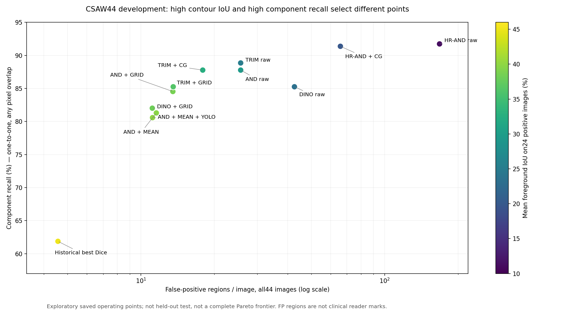
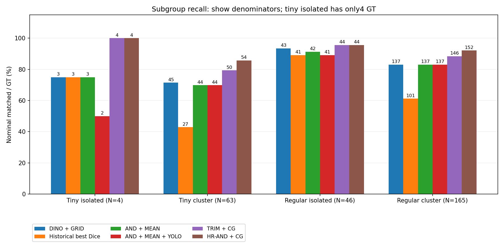

# Findings and research directions

Evidence date: November 15, 2026. This analysis uses the existing replay of 12 pipelines on CSAW44 and inspection of the previously prepared casesA/B/C. Neither the original handoff nor this English update adds a new medical-cohort evaluation. Proposed improvements are research hypotheses, not demonstrated gains.

## 1. Main finding

**Candidate generation, component verification, and contour delineation are separate tasks. A single Dice score does not measure all three.** The current bottleneck is reducing false alerts while retaining small and weak targets.

The saved model with the highest Dice misses many components. HDoG/TRIM recovers some components missed or merged by DINO. HR-AND obtains the most matches but retains many FPs after classification. The classifier is useful; the next question is how to verify a particular component and correct geometry within it.

YOLO has high proposal coverage, but most remaining FP pixels already lie inside its ROI. Hard cropping therefore removes relatively little FP and can delete a genuine tiny target. This explains its benefit on negative Case C and its cost on positive Case A.

## 2. Read these metrics together

CSAW44 contains 24 positive and 20 negative images under the project reference,278 GT components, and 67 tiny components. Dice/IoU are foreground macro averages on24 positive images. Component P/R pools counts across all44 images.

| Saved pipeline | Matched /278 | FN | FP regions | FP/image | Component precision | Component recall | Positive Dice | Positive IoU | Clean negatives /20 |
|---|---:|---:|---:|---:|---:|---:|---:|---:|---:|
| DINO20 RAW .60 |237|41|1876|42.64|11.22%|85.25%|36.32%|23.32%|0|
| DINO20 + GRID |228|50|490|11.14|31.75%|82.01%|53.18%|38.00%|2|
| Historical U10 + MEAN, highest saved Dice |172|106|201|4.57|46.11%|61.87%|59.54%|45.03%|4|
| HDoG AND .60 RAW |244|34|1129|25.66|17.77%|87.77%|44.42%|29.65%|0|
| HDoG AND + MEAN |226|52|509|11.57|30.75%|81.29%|55.85%|39.76%|3|
| HDoG AND + MEAN + YOLO |224|54|491|11.16|31.33%|80.58%|56.01%|40.08%|5|
| TRIM RAW |247|31|1129|25.66|17.95%|88.85%|38.82%|25.17%|0|
| TRIM + CG NP99 |244|34|789|17.93|23.62%|87.77%|47.39%|32.52%|0|
| HR-AND .05 RAW |255|23|7386|167.86|3.34%|91.73%|19.45%|11.29%|0|
| HR-AND .05 + CG |254|24|2895|65.80|8.07%|91.37%|31.41%|19.71%|0|

These are different operating points. Historical U10 and DINO20 also differ in weights/recipes; this table does not isolate architecture or classifier effects. Paired confidence intervals are unavailable for these differences, so small changes should not be called statistically meaningful.

HR-AND+CG retains254/255 raw matches and reduces FP from 7,386 to 2,895, about 60.8%. Verification clearly helps, but65.8 FP regions/image remain. An illustrative research budget of 4 FP/image permits at most176 FPs across 44 images. Retaining254 matches would require at least another93.9% reduction in current FPs. This arithmetic does not establish feasibility or clinical acceptability.

The highest saved Dice,59.54%, accompanies only 61.87% component recall. It is a contour-quality comparator rather than the default answer to a high-recall objective. AND+MEAN is a more balanced illustrated point, but its FP burden has not been accepted by clinicians.

This is not the optimal frontier over all models/thresholds. Markers have no confidence intervals; FP uses a logarithmic axis.

## 3. Four component subgroups

Tiny means area<11 native pixels. Isolated means the nearest other GT-centroid distance>128 native pixels. These are technical strata, not clinical cluster definitions. Only four tiny-isolated GT objects occur across three registered groups/patients, which is insufficient for broad superiority claims.

| Pipeline | Tiny isolated /4 | Tiny clustered /63 | Regular isolated /46 | Regular clustered /165 |
|---|---:|---:|---:|---:|
| DINO20 RAW |3|47|46|141|
| DINO20 + GRID |3|45|43|137|
| Highest-Dice U10 |3|27|41|101|
| HDoG AND .60 RAW |3|48|45|148|
| HDoG AND + MEAN |3|44|42|137|
| AND + MEAN + YOLO |2|44|41|137|
| TRIM RAW |4|50|45|148|
| TRIM + CG |4|50|44|146|
| HR-AND .05 RAW |4|54|45|152|
| HR-AND .05 + CG |4|54|44|152|

Some nominal subgroup counts can vary between maximum matchings of equal cardinality. Equal total matches do not establish that the same GT identities were preserved. The separate viewer marks M/A+/A−; the new evaluator also reports minimum/maximum subgroup counts to avoid false certainty.

The highest-Dice system matches128/228 clustered GT objects versus206/228 for HR+CG. A contour metric can improve when small/weak regions are discarded and clearer ones retained. This describes outputs, not proof that the model intentionally learned that strategy.

YOLO ROI covers275/278 GT objects but only 2/4 tiny-isolated objects. A hard-intersection system cannot recover objects entirely removed by its gate. The training cause of the detector's tiny misses has not been isolated.

## 4. Inspection of three cases

**Case A — tiny target and ROI gating.** G003 occupies only four pixels. A genuine reference-overlapping prediction exists before YOLO and disappears after gating. AND+MEAN obtains14/18 matches and 28 FPs; adding YOLO yields13/18 and 24 FPs while Dice increases39.27→42.45%. One change can improve a contour metric while worsening a low-miss objective.

TRIM+CG obtains18/18 with 32 FPs; HR+CG also obtains18/18 but with 63 FPs. TRIM+CG is preferable on matched/FP for this particular case. It does not dominate HR globally: Case B contains a GT found only by HR.

**Case B — clusters, merging, and weak candidates.** DINO obtains20/24 matches and 29 FPs. Geometry separates some predictions previously shared by multiple GT objects; TRIM+CG obtains23/24 and 32 FPs. Tiny G019 is missed by DINO/AND and recovered by TRIM. G023, a regular20-pixel component, is found only by HR/HR+CG.

HR+CG obtains24/24 with 185 FPs: precision11.48%, recall100%. TRIM+CG has precision41.82%, recall95.83%. Recovering the last GT is expensive in FP burden on this image. The cohort's highest-Dice model obtains only 13/24 here; cohort ranking does not guarantee a per-image win.

**Case C — negative under the reference.** DINO produces31 FPs; GRID and AND+MEAN retain one; YOLO removes the last FP. YOLO is useful in some cases, without negating its tiny-target loss in Case A. Recall has no denominator on a GT-empty image, and FP=0 does not establish absence of cancer.

The three images were deliberately selected from three different people to explain mechanisms, not estimate population failure rates. Their medical pixels/masks remain in the separate authorized viewer bundle and are not redistributed in this benchmark ZIP.

## 5. Improvement priorities

**P0 — audit references and measurement.** CSAW44 has repeatedly informed threshold sweeps; these are development-best results. Verify class mapping, completeness, linkage, resolution, and training exposure. The [CSAW-S paper](https://proceedings.mlr.press/v119/matsoukas20a.html) describes tumor segmentation. Trace the project's actual MC masks/code rather than inferring biological speck labels from the dataset name.

One-pixel overlap is lenient. A large prediction can match while carrying many FP pixels; a prediction touching two GT objects still matches only one. Report coverage, merge/split conflicts, and stricter coverage/IoU conditions. Pixel, object, and image metrics answer different questions. [Metrics Reloaded](https://www.nature.com/articles/s41592-023-02151-z).

**P1 — verify the intended component.** A patch classifier answers whether MC exists somewhere in a patch; a nearby FP may inherit a high score from a TP. Test a native-resolution detail crop, explicit component mask/center, and wider context crop. Compare local-only, then local+context, then global information to identify the source of any benefit.

Build verifier training examples from out-of-fold predictions on training data. Do not rely exclusively on GT-centered positives or mine test hard negatives. Negatives near TPs are valuable, but label them confidently only in sufficiently annotated regions; ignore/audit uncertain regions. Freeze labeling rules and retain each candidate's mask/identity. Evaluate recall at the same FP budget rather than classification accuracy/AUROC alone.

A global head can learn MC-presence from reliable training labels and local-candidate aggregation. Test it as context/risk information rather than hard-rejecting images before measuring missed targets. Retain native-resolution local detail because global downsampling can obscure tiny objects. MC-presence is not cancer classification.

**P2 — refine/split when the error is internal to a component.** Whole-component keep/drop cannot remove FP pixels attached to TPs or separate merged GT objects. Add a registered refinement head or splitting procedure, then relabel/recompute verification. Separate geometry, semantic verification, and refinement ablations.

Recropping/erasing may diagnose whether a classifier relies on the intended component or a nearby TP. Inference erasures must be prediction-derived, not GT-derived. Use controls, alternative fills, and bounded iterations. A changed logit alone is not causal evidence because erased images may be out of distribution.

**P3 — test YOLO as a prior.** AND+MEAN→+YOLO reduces509→491 FPs while reducing226→224 matches. Some 96.71% of original FP pixels lie inside ROI, so the gate cannot address most residual FP pixels. The existing cache uses native512 crops enlarged to 1024 rather than full-image downsampling. No evidence here establishes that tiny training labels were filtered out; do not assign either cause without an ablation.

Test soft ranking/prior information or a rescue branch outside ROI using strong local evidence. Compare at the same recall/FP budget instead of assuming an added stage helps.

## 6. Appropriate use cases

| Use case | Main objective | Starting point | Missing evidence |
|---|---|---|---|
| CAD / second reader | Sensitivity for relevant lesions at acceptable false marks/exam and reading time | High-recall candidates + verification + alert grouping | Clinical labels, reader study, workflow; FP regions are not displayed reader marks |
| Segmentation-method paper | Held-out positive-image foreground IoU, with Dice/detection/negative metrics | Highest saved Dice as comparator; common recipes and mask refinement | Clean test, seeds/folds, strong baselines, and a substantive contribution |
| Annotation assistant | Few misses, fewer corrections, faster completion | TRIM/HR with interactive candidate ranking | Clicks, time-to-correct, and final expert mask quality |
| Morphometry research | Area/shape/count errors and merge/split behavior | Precise contours and instance audit | References for the actual biological objects;8CC is not automatically speck count |
| Triage / negative filtering | Exam/patient FN, sensitivity/NPV at real prevalence | Global+local research risk ranking | Insufficient evidence to skip reading or infer absence of cancer |
| Dataset QA | Find missing/inconsistent annotations worth reviewing | Model disagreement + expert audit | Prediction outside a reference is not automatically a biologically false MC |

The nearest practical research direction is **benchmarking plus annotation assistance/research CAD**. For a reader-facing tool, define which MCs matter, why they are marked, and what readers do with alerts. No universal clinically acceptable FP budget follows from these data.

Use constrained evaluation objectives such as `maximize recall subject to FP/image <= B`, or `maximize IoU_positive` with recall/negative burden still reported. Training loss is a surrogate; arbitrary FN/FP weights do not establish clinical utility.

## 7. Publication and clinical paths

| Direction | Research question | Additional evidence | Current assessment |
|---|---|---|---|
| CS / computer vision | What general method improves tiny detection–segmentation tradeoffs, and why do rankings change? | Controlled ablations, strong baselines, generalization, reproducible code, methodological benchmark value | Promising failure analysis; model stacking/threshold tuning alone is limited |
| Biomedical imaging / engineering | How robust is the system across scanners, cohorts, and references? | Annotation audit, group/patient testing, external data, seeds/folds, compute, clinical interpretation | **Best fit if the benchmark and method are completed rigorously** |
| Clinical / radiology | Does AI help readers detect relevant findings and work effectively? | Intended use, diagnostic reference, representative external data, multireader/multicase evaluation, reading time | Dice and 8CC do not establish this benefit |
| Clinical deployment | Is the tool safe/reliable in the specified workflow? | Clinical partner, ethics, software verification/validation, human factors, regulatory pathway, monitoring | Separate stage after research validation |

These are project-fit recommendations, not acceptance guarantees. Example scopes: [Medical Image Analysis](https://shop.elsevier.com/journals/medical-image-analysis/1361-8415), [IEEE TMI](https://www.embs.org/tmi/), and [Radiology: Artificial Intelligence](https://pubs.rsna.org/page/ai/author-instructions). Choose by contribution and evidence rather than IoU alone.

Suggested topic: **“Detection–segmentation tradeoffs for tiny calcification references: a reproducible benchmark and component-conditioned verification.”** A benchmark needs useful protocol/baselines/error analysis, not just a multi-model score table. If verification gains are unstable, report an ablation/negative finding instead of claiming SOTA.

Suggested outline: (1) data/reference audit; (2) classical, scratch, and foundation baselines; (3) metric rankings, tiny/cluster strata, merge/split errors; (4) verifier/refiner ablations; (5) external robustness, compute, reproducibility. [CLAIM2024](https://pmc.ncbi.nlm.nih.gov/articles/PMC11304031/) helps report imaging AI transparently but does not replace experimental evidence.

For live-workflow research, evaluate human–AI interaction, safety, and usability; [DECIDE-AI](https://www.nature.com/articles/s41591-022-01772-9) concerns early-stage live clinical evaluation. A retrospective segmentation experiment is not that study.

For intended use in the US, medical-image analysis supporting diagnostic decisions may be regulated as a medical-device function. A clinician making the final decision does not automatically establish an exemption. Define intended use and the relevant pathway with appropriate expertise. [FDA CDS guidance](https://www.fda.gov/regulatory-information/search-fda-guidance-documents/clinical-decision-support-software), [FDA CDS decision step](https://www.fda.gov/medical-devices/digital-health-center-excellence/step-6-software-function-intended-provide-clinical-decision-support).

## 8. Limitations to preserve in conclusions

- No new test set; saved best points were adapted to development44, without independent generalization confirmation.
- Different recipes/weights/epochs/pretraining prevent architecture-only attribution.
- Tiny-isolated N=4; a few pixels of annotation uncertainty can change subgroup conclusions.
- No reader burden measurement, cancer labels, or prospective outcomes; clinical readiness is unestablished.
- HDoG+DINO geometry is not full HDoGReg with FPN. TRIM is not image–text CLIP. NP99 is a previous calibration point, not guaranteed99% retention on a new candidate pool.
- Released HDoGReg inference was rerun on INbreast94, but training/validation image exposure remains uncertain; it is not a clean zero-shot external comparator.
- INbreast final-report tables and CSAW44 use different cohorts/aggregation. Do not infer a winner by comparing Dice across them.

## 9. Recommended next actions

Freeze existing evidence and assign U-Net/nnU-Net/DINO under the shared protocol. In parallel, train an OOF component verifier and test a mask refiner with controlled ablations. Prioritize recall at a fixed FP budget and contour IoU on a new test. When the tradeoff is stable, work with readers to determine which alert burden is useful.

See the separate [protocol](../docs/PROTOCOL.md), [model readiness](../docs/MODEL_READINESS.md), and [organizer checklist](../NEXT_STEPS.md).
